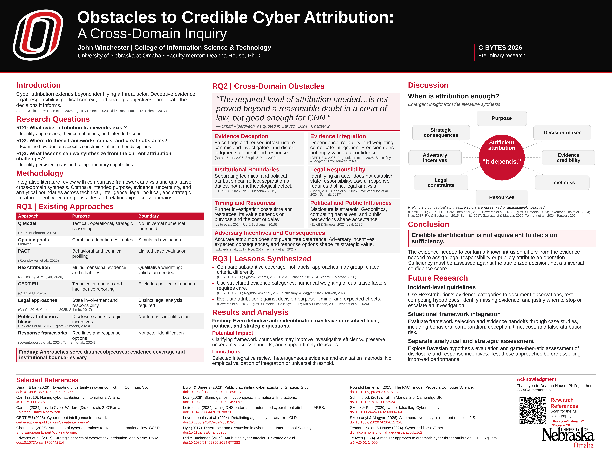

# CBytes-2026

Initial Pitch:

"When a cyberattack occurs, how certain do we need to be about who did it? And when is that certainty enough to act?

Through an integrative literature review, I found that a security operations center and a government responding to a nation-state attack may need very different levels of attribution.

Existing frameworks help answer different parts of that question, but deceptive evidence, institutional boundaries, and competing legal and strategic requirements can make attribution harder to use in practice.

Even knowing exactly who attacked you doesn't necessarily tell you what to do next.

Moving forward, I want to explore how we can bring these frameworks together and better understand when further investigation is worth the time and resources.

The goal of this research is to help decision-makers understand when they have enough information to act, even when complete certainty isn't possible."

The pitch is expected to change over time as we continually talk about the subject. 

References:

https://github.com/HatmanW/CBytes-2026/blob/main/README_APA_39_sources.md

Disclosure:

https://github.com/HatmanW/CBytes-2026/blob/main/AI_Disclosure
